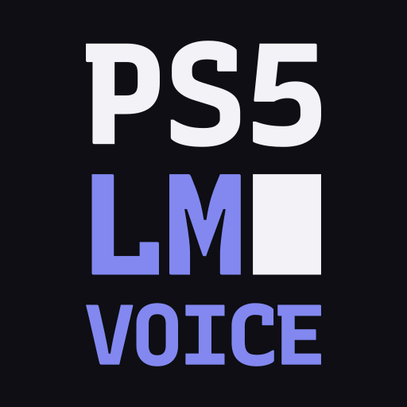
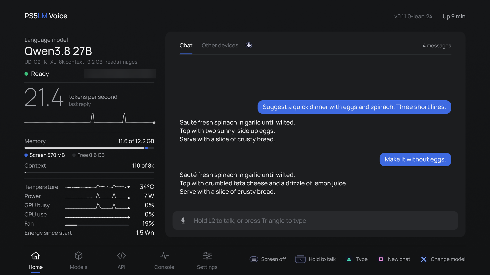
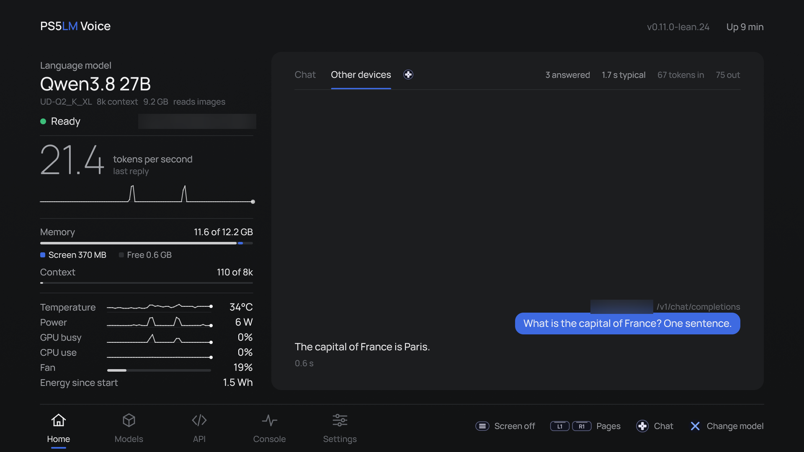
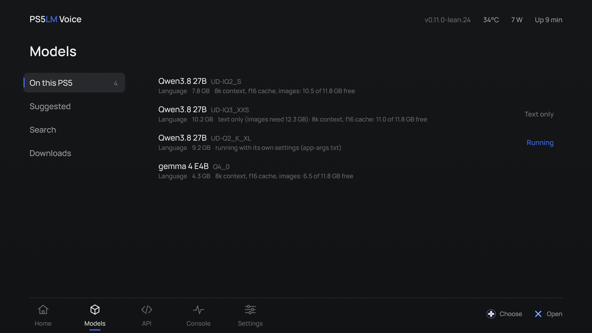
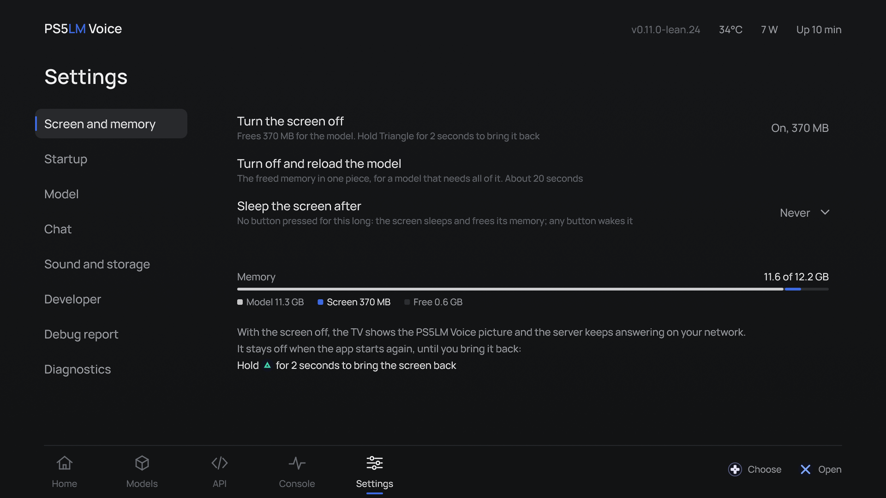

  

<h1 align="center">PS5LM Voice</h1>

  <b>Talk to a 27B language model running on your PS5, from the couch.</b> 
  A fork of <a href="https://github.com/cobanov/PS5LM">PS5LM</a> with push-to-talk on the controller, a chat-first
  Home screen and about 0.7 GB more memory for the model.

  <b><a href="https://github.com/Adon1s/PS5LM-Voice/releases/latest">Get the app</a></b> ·
  <a href="#install">Install</a> ·
  <a href="#using-it">Using it</a> ·
  <a href="FORK.md">Every change, measured</a> ·
  <a href="https://github.com/Adon1s/PS5LM-Voice/issues">Issues</a>

  
   Home on a PS5 Slim: Qwen 3.8 27B remembers the conversation. Hold L2 to talk, R2 to send.

  
  
  
   Requests from other devices, the Models page and Settings > Screen and memory.

PS5LM Voice is [cobanov/PS5LM](https://github.com/cobanov/PS5LM) (GPL-3.0) with changes aimed at using the model on
the console itself, not only from other devices. Hold L2 on the DualSense and speak, let go, and press R2: the
console turns your speech into text on its own CPU, sends it to the model, and keeps the conversation on the TV.
Everything PS5LM does still works: the OpenAI and Anthropic APIs on port 8081, the planner, downloads, decision
models and the Console page.

It installs beside stock PS5LM under its own title ID, **PPSA99590**, and shares its data folder (`/data/PS5LM`), so
your models and settings carry over. Run one of the two at a time.

## What it adds

- **Voice chat on the TV.** Hold L2 to talk, R2 to send. Speech-to-text runs on the console with
  [whisper.cpp](https://github.com/ggml-org/whisper.cpp): a 12-second sentence came back word for word in 1.7 s,
  while the language model kept generating at its full speed. The conversation is kept, so follow-up questions
  work ("How many people live there?" after asking about Paris).
- **A chat-first Home.** The conversation fills two thirds of the screen; the model, its speed, memory, context and
  the console's temperature, power and load sit in a rail on the left. Requests from your other devices are one
  tab away.
- **About 0.7 GB more memory for models.** llama.cpp's schedulers reserved room for one graph split per node, about
  720 MB the model never used. With that fixed (plus a heap that hands memory back and a vision warm-up that sizes
  the image encoder once), Qwen 3.8 27B with vision is ready with 1.79 GB free instead of 1.08 GB, and stays flat
  through 25 photos.
- **No more stalls.** The app's log goes through a memory buffer instead of writing straight to `/data`, where one
  slow write could freeze the whole app ([cobanov/PS5LM#70](https://github.com/cobanov/PS5LM/issues/70)).
- **The screen can step aside.** Turning the screen off frees about 370 MB for the model, in place and without a
  reload; one button brings it back in about 0.2 s. A sleep timer (5 minutes to 1 hour) does it by itself.
- **Qwen 3.8 27B with vision at an 8k context**, as UD-Q2_K_XL (9.2 GB) with its F16 projector, screen on: about
  20-23 tokens a second, about 12 s a photo. Models load about 5x faster (20 s instead of 1 min 40 s for 8.4 GB).
- **A planner that knows the new memory.** The Models page says when a model fits only with the screen off, or only
  text only, and offers to load it that way.

[FORK.md](FORK.md) lists every change, newest last, with what was measured on the console.

## What you need

The same console and payloads as PS5LM: a PS5 on firmware 7.00 to 13.60, jailbroken, with these payloads loaded.

| Payload | For | |
|---|---|---|
| [kstuff-lite](https://github.com/EchoStretch/kstuff-lite) | the kernel patches homebrew runs on | required |
| [etaHEN](https://github.com/etaHEN/etaHEN) | homebrew support | required |
| [ShadowMountPlus](https://github.com/drakmor/ShadowMountPlus) | puts the app on the home screen from `/data/homebrew` | required |
| [elfldr](https://github.com/ps5-payload-dev/elfldr) (port 9021) | temperature, power and real free space, through ps5-exporter; full-speed downloads | recommended |
| [ftpsrv](https://github.com/ps5-payload-dev/ftpsrv) (port 2121) | installing the app, copying models from a PC | recommended |

For voice: a DualSense (its built-in microphone) and the whisper model below.

## Install

1. Download `ps5lm-voice-<version>.zip` from the
   [latest release](https://github.com/Adon1s/PS5LM-Voice/releases/latest) and check it against the `.sha256` file
   beside it. Unzip it.
2. Copy the `PPSA99590` folder to `/data/homebrew` over FTP. ShadowMountPlus adds **PS5LM Voice** to the home
   screen. Stock PS5LM (`PPSA99575`) can stay installed.
3. For voice, download
   [`ggml-base.en-q5_1.bin`](https://huggingface.co/ggerganov/whisper.cpp/blob/main/ggml-base.en-q5_1.bin)
   and copy it to `/data/PS5LM/whisper/`.
4. Open PS5LM Voice, go to **Models > Suggested** and get a model, or copy a `.gguf` to `/data/PS5LM/models`. Load
   it. Once Home says Ready, hold L2 and talk.

To update, copy the new `PPSA99590` folder over the old one. Settings, models and downloads stay in `/data/PS5LM`.

If the app cannot write to `/data/PS5LM`:

- **OnionHEN:** add `PPSA99590` to `exact_title_ids` in the `[app_jailbreak]` section of
  `/data/OnionHEN/config.ini` (as for stock PS5LM's `PPSA99575`), then start the app again.
- **etaHEN:** over FTP, create `/data/PS5LM/models` and give `/data/PS5LM` and everything in it mode 777.

## Using it

| Where | Button | Does |
|---|---|---|
| Home, Chat | hold L2 | talk; let go and the transcript goes into the box |
| Home, Chat | R2 | send |
| Home, Chat | Triangle | type instead |
| Home, Chat | Square twice | start a new chat |
| Everywhere | Options | turn the screen off (asks first) |
| Screen off | hold Triangle 2 s | bring the screen back |
| Screen asleep | any button | wake it |
| Everywhere | L1 / R1 | Home, Models, API, Console, Settings |
| Home | Cross | change the model |

- **Screen and memory** is the first category in Settings: turn the screen off in place, turn it off and reload the
  model (the memory in one piece), and "Sleep the screen after" (never, 5, 15 or 30 minutes, or 1 hour).
- The whisper model loads on the first L2 press (152 MB) and unloads after 10 idle minutes or when the screen goes.
- Other devices use the console exactly as with PS5LM: point an OpenAI or Anthropic client at
  `http://<console>:8081`. Coding tools are in [docs/CLI.md](docs/CLI.md), request files from a PC in
  [docs/CONSOLE.md](docs/CONSOLE.md).

## Limits, honestly

- **Tested on one console:** a PS5 Slim on firmware 12.40, mostly with Qwen 3.8 27B. Other models and consoles
  should work as they do on PS5LM, but nobody has checked yet.
- **English only.** The suggested whisper model is `base.en`. Sometimes a stray first word appears in the
  transcript.
- **Chat formatting:** math shows as raw LaTeX, and code lines lose their indentation on the TV.
- **The browser chat page** on port 8081 is not in this build; the APIs answer as usual.
- **Built but not tried on the console:** pairing a vision projector by its file header when its name doesn't
  match, and loading such a model by a click in the library.
- The planner's memory figures are fitted to Qwen 3.8 27B; other models may be planned a little loosely.

## The rest of PS5LM

Everything from PS5LM v0.11.0 is here: decision models through `/v1/systemone`, Ternary Bonsai 2, the opt-in
`/v1/introspect` endpoint ([docs/INTROSPECTION.md](docs/INTROSPECTION.md)), the experimental multi-console
[fleet](docs/FLEET.md) and the Console page. PS5LM's [README](https://github.com/cobanov/PS5LM#readme) describes them.

[Building](docs/BUILDING.md) · [Console notes](docs/CONSOLE.md) · [CI](docs/CI.md) ·
[Models that fit](docs/MODELS.md) · [Changelog](CHANGELOG.md)

## Thanks

- [cobanov](https://github.com/cobanov) for PS5LM, which this is built on, and everyone credited in
  [its README](https://github.com/cobanov/PS5LM#thanks).
- [llama.cpp, ggml](https://github.com/ggml-org/llama.cpp) and [whisper.cpp](https://github.com/ggml-org/whisper.cpp),
  which do the actual work.
- [ntindle](https://github.com/ntindle) for the memory pool and faster model reads
  ([cobanov/PS5LM#73](https://github.com/cobanov/PS5LM/pull/73), [#74](https://github.com/cobanov/PS5LM/pull/74)).
- [Mihawk-99](https://github.com/mihawk-99) for PS5_Vulkan and the payload SDK whose heap fixes this app carries.
- [Marice](https://github.com/Marice/ps5-exporter) for ps5-exporter, which the app carries.

---

GPL-3.0-or-later, see [LICENSE](LICENSE). llama.cpp and whisper.cpp keep their MIT licence, Manrope its OFL. No Sony
SDK files, keys, firmware or model weights are in this repository or its releases.

PS5LM Voice is not affiliated with Sony Interactive Entertainment or with the PS5LM project. "PlayStation" and "PS5"
are trademarks of Sony Interactive Entertainment.
